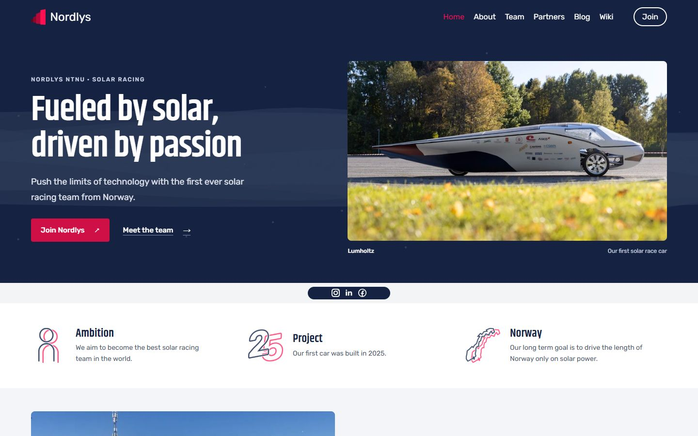

# Wider desktop homepage: issue #38

Proposal on `fix/38-wide-desktop-layout`, based on `main` at `99325ac`.
The design is ready for review before merging or deploying, and #38 is still open.

## What changed

- The homepage uses up to 82rem of content width. The navigation, images and sections line up with the same edges.
- The opening section puts the existing headline next to a real photo of Lumholtz, with links to join and meet the team.
- The three goals use smaller icons beside the text instead of large icons above it.
- The project section shows the team and car at Rudskogen. This and the opening image already existed in the repository.
- The latest blog post is a short preview with one image. Both the image and "Read update" open the full post, where the existing five-photo gallery is still available.
- All seven groups fit on one row on desktop. The grid and the other sections adapt to smaller screens.
- The mobile menu is a labelled keyboard-operable button. The homepage also has a skip link and visible keyboard focus styles.

The homepage keeps the existing Rubik/Khand fonts and navy/pink colours. Most changes are in homepage components. The shared content and navigation styles use optional CSS variables, with their original values as fallbacks on other pages. The old landing styles used by the 404 page are separate from the new homepage styles.

## Before and after

Measured locally in the in-app browser. Page height includes the contact section and footer; this is a layout comparison, not a performance benchmark.

| Viewport | Before | After | Reduction in page height |
| --- | ---: | ---: | ---: |
| Desktop, 1440 x 900 | 3826px | 2820px | 26.3% |
| Mobile, 390 x 844 | 5917px | 4106px | 30.6% |

At the desktop comparison size, content width increases from 1000px to about 1310px. On a 1920px screen it stops at 1312px so text does not stretch across the whole screen.

Full screenshots: [desktop before](before-desktop.jpg), [desktop after](after-desktop.jpg), [mobile before](before-mobile.jpg), [mobile after](after-mobile.jpg).
The measured viewport sizes and dimensions are in [measurements.json](measurements.json).

## Checks

- Production build and static export passed using Next.js 16.4.1 and `next build --webpack` in an isolated local copy with the existing dependencies. No dependency or lockfile changes.
- Checked widths of 320, 390, 768, 900, 1100, 1280, 1440 and 1920px. No horizontal page overflow was found. The homepage has one H1 at each size.
- Opened and closed the mobile menu, opened it with Enter, and verified that resizing to desktop closes it before returning to mobile.
- Reached the skip link with Tab and followed it to the homepage content.
- Followed "Read update" to `/blog#latest-post`; the post settles below the sticky navigation. Opened the gallery and confirmed it still contains all five photos.
- Followed the About, Team and Join links. Their content/navigation widths keep the original 1000px limit; homepage CSS variables do not carry over.
- All 39 local assets referenced by the exported homepage exist. No warnings or errors were recorded in the homepage browser console during the initial checks.
- `git diff --check` passed. Existing local changes in `next-env.d.ts` and `tsconfig.json` were preserved and are outside this change.

The wider site asset check also found an existing About-page poster reference to `/posters/compressed/AboutVideo.png`; the available file is a JPG. The same missing reference is present in the baseline. It is outside this homepage proposal.

## Review

The current local preview is at <http://127.0.0.1:3008/>. The earlier homepage is available at <http://127.0.0.1:3007/> while that preview server is running.

The next decision for #38 is whether this wider direction works for Nordlys. Useful things to review are the image cropping, the shorter news preview and the amount of space between sections.

This branch starts from `main`. The paused #62 / Project 2027 team work remains in its own branch and preview. Team membership, recruitment information and contact details have not been updated as part of this layout proposal.
